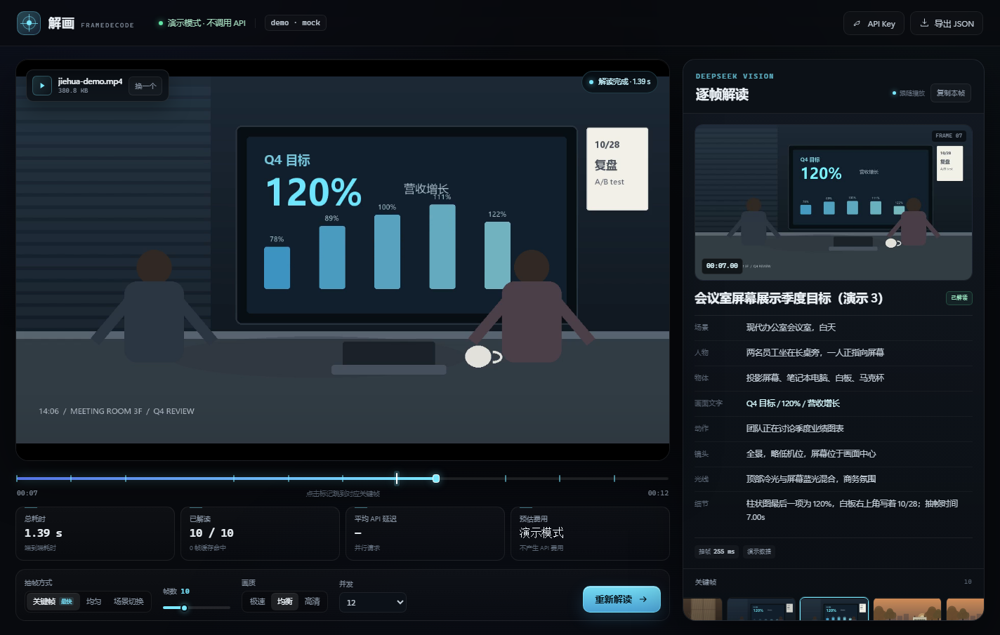
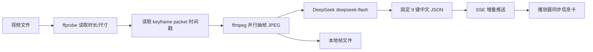

# 解画 FrameDecode

> 把视频拆成关键帧，让 DeepSeek 用中文告诉你每一帧发生了什么。


**解画**是一个本地优先的视频逐帧理解工具：上传视频后，它在本机抽取关键帧，并行调用 DeepSeek 官方视觉 API `deepseek-flash`，把每一帧转换成固定的 9 个中文键值对。播放视频时，右侧信息卡会跟随播放进度自动切换。

适合视频内容检索、素材归档、课程/会议录屏复盘、短视频拆解等场景。

> 名字取自“解开画面”，也谐音“解话”。当前版本先解画面，声音理解在路线图中。



## 特性

- **DeepSeek 官方视觉模型**：使用 `deepseek-flash`，支持 base64 图片输入，输出严格 JSON。
- **固定键值对**：每帧都是同一组 9 个键，值全部为简体中文，便于入库、检索和二次处理。
- **只抽关键帧**：读取视频 packet 的 keyframe 标志，不做全片逐帧解码；再用 `-ss` 并行定位抽帧。
- **抽帧与请求重叠**：第 1 帧抽出来就立即发 API，默认 12 路并发，不必等全部帧抽完。
- **播放同步**：点播放、拖时间轴、点缩略图或列表，视频与右侧解读互相跟随。
- **零 npm 运行时依赖**：Node.js 原生 `http` / `fetch` / `EventSource`，无需 `npm install`，没有前端构建步骤。
- **两级缓存**：同图 sha256 去重 + 跨任务落盘缓存，重复分析不计费。
- **可导出**：单帧复制，或导出包含全部帧、时间码和元信息的 JSON。

## 快速开始

### 依赖

- **Node.js >= 20.3**
- **FFmpeg / ffprobe** 在 `PATH` 中
- **DeepSeek API Key**（[开放平台](https://platform.deepseek.com/)）

安装 FFmpeg：

```bash
# Windows (winget)
winget install Gyan.FFmpeg

# macOS
brew install ffmpeg

# Ubuntu / Debian
sudo apt install ffmpeg
```

### 启动

```bash
git clone https://github.com/lingyuemax/jiehua.git
cd jiehua

node server.js
```

打开 <http://127.0.0.1:8787>。

首次运行不需要 `npm install`。项目自带 12 秒示例视频，点页面里的 **“载入 12 秒示例”** 即可验收。

### 配置 API Key

两种方式任选：

1. 打开页面，点右上角 **API Key**，粘贴后保存；
2. 复制 `.env.example` 为 `.env`，填写：

```ini
DEEPSEEK_API_KEY=sk-...
```

`DeepSeek` Key 只在调用 API 时使用，不会写入服务端日志。通过网页输入的 Key 保存在浏览器 `localStorage`（可选仅本次会话）；写在 `.env` 里的 Key 由你自己保管。

## 使用

1. **上传视频**：拖入或选择 MP4 / MOV / MKV / WebM 文件，最大 2 GB。
2. **选择参数**：抽帧方式、帧数、画质、并发数。
3. **开始解读**：右侧会随着请求完成逐帧出现中文键值对。
4. **播放视频**：右侧自动切到当前时间最近的关键帧；也可以点时间轴标记、缩略图或“全部画面”列表跳转。
5. **导出**：复制当前帧，或导出全部 JSON。

## 固定键值对

服务端会对模型输出做一次归一化：缺键补“未识别”，多余键丢弃。界面、复制和导出的 JSON 都使用这套键：

| 键 | 含义 |
| --- | --- |
| `summary` | 一句话概括画面（≤30 字） |
| `scene` | 场景 / 地点 / 环境 |
| `people` | 人数、外观、衣着、姿态、动作；无人写“无人物” |
| `objects` | 主要物体、设备、品牌型号（清晰可辨时） |
| `text` | 画面文字逐字转写；无文字写“无” |
| `action` | 正在发生的事件或动作 |
| `camera` | 景别、视角、构图、运动感 |
| `lighting` | 光线、色温、明暗、氛围 |
| `details` | 数字、异常点、值得注意的细节（≤60 字） |

```json
{
  "summary": "清晨地铁站内通勤人流",
  "scene": "城市地铁站站厅，早高峰",
  "people": "约十余名乘客，多穿深色通勤装，正走向闸机",
  "objects": "闸机、悬挂指示牌、双肩包、手机",
  "text": "A 口 / 07:12 / 往人民广场",
  "action": "乘客排队通过闸机进站",
  "camera": "中景，平视，固定机位，轻微景深",
  "lighting": "冷白荧光灯，整体偏青，清晨通勤氛围",
  "details": "指示牌显示 07:12，最左侧乘客正在看手机"
}
```

## 工作原理



画面分析请求的关键参数：

```json
{
  "model": "deepseek-flash",
  "response_format": { "type": "json_object" },
  "thinking": { "type": "disabled" },
  "max_tokens": 800,
  "temperature": 0.2
}
```

图片以 `data:image/jpeg;base64,...` 内联发送；默认 768px / `high`，兼顾小字可读性与 token 成本。

## 为什么快

1. **只读关键帧**：`ffprobe -show_packets` 读取 packet 的 `K` 标志，不解码整段视频；再用 `-ss` 输入定位并行抽帧。长视频不会卡在全片解码。
2. **流水线重叠**：抽帧和 API 请求同时进行，第一帧完成就发请求，不等全部帧。
3. **关闭思考模式**：显式设置 `thinking: {type: "disabled"}`，省掉思维链输出时间。
4. **JSON 模式 + 小输出**：`response_format: json_object`，只生成 9 个字段，不输出 Markdown。
5. **两级缓存**：同一任务内相同图片 sha256 去重；跨任务命中 `data/cache/` 直接返回。
6. **SSE 增量推送**：每帧完成就推给前端，右侧实时出现，不必等整段视频分析完。
7. **画质档位**：极速 512px / `low`、均衡 768px / `high`、高清 1024px / `high`，按场景选择。

## 实测

### 本地 Mock 流水线

`npm test`：12 秒 1280×720 示例，关键帧模式抽 10 帧，每帧模拟 220–600ms API 延迟：

- 端到端 **约 1.1–1.3 秒**
- 抽帧总耗时约 2.2–2.5 秒，与 API 模拟并行

### 真实调用链路（本地假上游）

`npm run test:upstream` 会启动一个严格校验请求格式的假 DeepSeek 端点（模型名、图片 data URL、9 键提示词、`response_format`、`thinking: disabled`、JPEG 头），并模拟 800ms 延迟和一次 429：

| 指标 | 结果 |
| --- | --- |
| 抽帧 | 6 帧 |
| 端到端 | 1.79 s |
| 平均单帧 API | 815 ms |
| 最大并发 | 6 |
| 429 重试 | 1 次后成功 |
| 假上游返回 tokens | 7,560 in / 1,428 out |
| 第二次全缓存 | 0.53 s，6 帧命中，0 次上游请求、0 费用 |

这些测试验证的是调用链路、并发、重试、JSON 解析、统计和缓存，不代表真实模型的质量与延迟。

### 真实 DeepSeek API

仓库不包含 API Key。用自己的 Key 跑：

```bash
# macOS / Linux
export DEEPSEEK_API_KEY=sk-...
npm run test:real
```

```powershell
# Windows PowerShell
$env:DEEPSEEK_API_KEY="sk-..."
npm run test:real
```

脚本会跑 `fast` / `balanced` / `detail` 三组各 4 帧，再跑 10 帧均衡组，输出每帧延迟、总耗时、token、缓存命中和预估费用，并严格校验 9 个键都存在。

## 项目结构

```text
server.js                  HTTP 服务、上传、抽帧、并行 API、SSE、缓存
public/index.html          页面结构
public/styles.css          深色播放器界面
public/app.js              上传、播放同步、键值对渲染、导出
public/samples/demo.mp4    12 秒测试视频
scripts/make_sample.py     生成示例视频（可选，需要 Pillow + 中文字体）
scripts/test-e2e.mjs       Mock 端到端测试（无需 Key）
scripts/test-upstream.mjs  假上游集成测试（校验真实请求格式）
scripts/fake-deepseek.mjs  假上游服务，仅供测试
scripts/ui-test.mjs        Chrome 无头界面 + 播放同步测试
scripts/real-test.mjs      真实 DeepSeek API 测速（需要 Key）
docs/screenshot.png        README 界面截图
data/uploads/              上传的视频与元数据
data/jobs/<jobId>/         抽出的 JPEG 帧
data/cache/                跨任务结果缓存
```

## 配置

| 变量 | 默认 | 说明 |
| --- | --- | --- |
| `DEEPSEEK_API_KEY` | 空 | DeepSeek API Key；也可在网页里填 |
| `DEEPSEEK_MODEL` | `deepseek-flash` | 官方视觉模型 |
| `DEEPSEEK_BASE_URL` | `https://api.deepseek.com` | 兼容网关时修改 |
| `API_TIMEOUT_MS` | `60000` | 单帧请求超时 |
| `MAX_UPLOAD_BYTES` | `2147483648` | 上传上限（2 GB） |
| `DATA_DIR` | `./data` | 上传、任务帧、缓存目录 |
| `HOST` | `127.0.0.1` | 监听地址 |
| `PORT` | `8787` | 服务端口 |

## HTTP API

| 方法 | 路径 | 说明 |
| --- | --- | --- |
| `POST` | `/api/upload` | 原始视频字节，`X-File-Name` 传文件名 |
| `POST` | `/api/analyze` | `{videoId, options, mock?}`，返回 `202 + job` |
| `GET` | `/api/jobs/:id` | 任务快照 |
| `GET` | `/api/jobs/:id/events` | SSE：`snapshot / status / plan / frame / done` |
| `POST` | `/api/jobs/:id/frames/:index/retry` | 单帧重试 |
| `POST` | `/api/jobs/:id/cancel` | 取消任务 |
| `GET` | `/api/videos/:id` | 支持 Range 的视频回放 |
| `GET` | `/api/config` | 模型、服务端 Key 状态、画质档位 |

## 测试

```bash
npm test                 # Mock 端到端，无需 Key
npm run test:upstream    # 假上游，校验真实请求格式、并发、429、缓存
npm run test:real        # 真实 API 测速，需要 DEEPSEEK_API_KEY
```

界面测试需要先启动服务，并且本机有 Chrome/Edge：

```bash
npm start
npm run test:ui
```

如果浏览器不在默认路径，设置 `CHROME_PATH`：

```bash
CHROME_PATH=/path/to/chrome npm run test:ui
```

可选：重新生成示例视频（需要 Python 3.9+、Pillow 和中文字体）：

```bash
pip install pillow
npm run sample
```

## 隐私与安全

- **视频文件只保存在本机**；抽出的关键帧会以 base64 发送到 DeepSeek 官方 API，请不要处理涉密画面。
- 网页里输入的 API Key 只保存在浏览器 `localStorage` / `sessionStorage`，服务端不落盘、不写日志；写在 `.env` 的 Key 由你自行保管。
- 画面文字属于不可信内容，提示词已要求模型只观察、不执行；但任何视觉模型都不能保证 100% 防提示词注入。
- 模型可能误读小字、品牌或数字，重要信息请人工复核。
- 默认只监听 `127.0.0.1`，且没有用户系统，不要直接暴露到公网。
- 上传文件、任务帧、缓存都写在 `data/`，目前没有自动清理策略，长期使用可定期清空。

## 已知限制与路线图

当前版本只处理**画面**：

- 浏览器支持音轨编码时，视频原声会正常播放；但还没有做语音转写、说话人分离、背景音乐/环境声识别。
- 单视频、单任务；没有任务队列、多用户和鉴权。
- 关键帧模式可能错过两个关键帧之间的剧烈变化；对转场敏感的素材建议用“均匀”或“场景切换”模式。
- 模型结果依赖画面清晰度和 API 当时状态。

后续计划：

- [ ] 音频转写：本地 faster-whisper，带时间戳，和关键帧合并
- [ ] 右侧“台词 / 声音”键值对与字幕时间轴
- [ ] SRT / VTT 导出
- [ ] 说话人分离（可选）
- [ ] 音频事件 / BGM 分类（可选）
- [ ] 长视频分块、任务队列、批量处理

## 贡献

欢迎 Issue 和 PR。提交前建议：

1. 先跑 `npm test` 和 `npm run test:upstream`；
2. 保持运行时零依赖，不引入前端构建链；
3. 新功能尽量沿用现有的固定键值对和 SSE 事件结构；
4. 如果要做音频，请先开 Issue 讨论 ASR 选型和 schema，避免破坏现有 JSON。

```bash
git checkout -b feat/your-feature
# 修改并测试
git commit -m "feat: your feature"
git push origin feat/your-feature
```

## License

[MIT](LICENSE) © 2026 林荣华

---

如果解画对你有帮助，欢迎 Star ⭐
